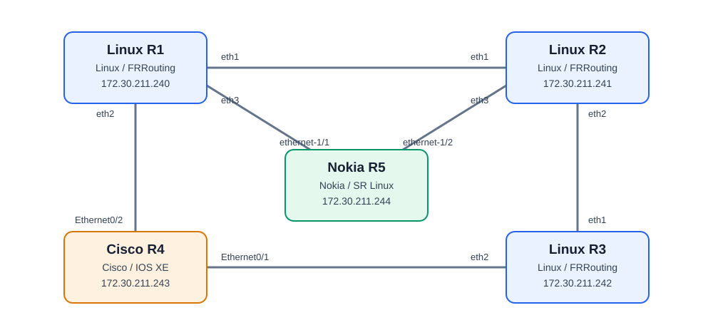

# Network AI Discovery Lab

A network automation lab built with Containerlab, NetBox, Python and Cisco IOL.

The goal is to progressively implement SSH/LLDP discovery, NetBox topology synchronization, MCP tools and AI-assisted network operations.

## Architecture

Five routers: three Linux/FRRouting, one Cisco IOS XE and one Nokia SR Linux.



All management IP addresses belong to `172.30.211.0/24`.
Data-plane links do not use these management IP addresses.

| Device | Platform | Management IP |
|---|---|---|
| linux-r1 | Ubuntu / FRR / LLDP | 172.30.211.240 |
| linux-r2 | Ubuntu / FRR / LLDP | 172.30.211.241 |
| linux-r3 | Ubuntu / FRR / LLDP | 172.30.211.242 |
| cisco-r4 | Cisco IOL IOS XE 17.18.02 | 172.30.211.243 |
| nokia-r5 | Nokia SR Linux 26.7.2 | 172.30.211.244 |

Linux routers provide SSH, FRRouting and LLDP.
Cisco R4 provides SSH and LLDP.
Nokia R5 provides SR Linux CLI and LLDP.

## Requirements

- Ubuntu/Debian or WSL2
- Docker and Containerlab
- Python 3
- Cisco IOL image built locally from a legally obtained Cisco CML image

Cisco images and licenses are not distributed with this repository.

## Cisco Image Build

Cisco IOL images are proprietary and are not included in this repository.

Obtain `iol-xe-17-18-02.tar.gz` from a properly licensed Cisco CML installation.

Build the image using the pinned revision of the vrnetlab fork:

```bash
./scripts/cisco-build.sh /path/to/iol-xe-17-18-02.tar.gz
```

The resulting local image is `vrnetlab/cisco_iol:17.18.02`.

## Quick Start

Clone the repository:

```bash
git clone https://github.com/vlimagit/network-ai-discovery-lab.git
cd network-ai-discovery-lab
```

Install dependencies:

```bash
./scripts/setup.sh
```

Configure `.env`:

```dotenv
CISCO_USERNAME=admin
CISCO_PASSWORD=admin
```

The Cisco image `vrnetlab/cisco_iol:17.18.02` must be built locally before deploying the network.

Start NetBox:

```bash
./scripts/start.sh
```

NetBox: http://127.0.0.1:8000

Deploy the network:

```bash
./scripts/lab-start.sh
```

The startup script builds the Linux router image, deploys five routers and configures Cisco R4 through SSH using Netmiko.

Verify the lab:

```bash
./scripts/lab-check.sh
```

## Hostname Resolution

### Windows – NetBox

Add the following entry to the Windows hosts file:

File: `C:\Windows\System32\drivers\etc\hosts`

    127.0.0.1 netbox

Open the file as Administrator from PowerShell:

    Start-Process notepad.exe -Verb RunAs -ArgumentList "$env:SystemRoot\System32\drivers\etc\hosts"

NetBox:

[http://127.0.0.1:8000](http://127.0.0.1:8000)

### Ubuntu / WSL2 – Network Devices

Configure network device hostnames automatically:

    ./scripts/configure-hosts.sh

The script updates `/etc/hosts` with the lab device management addresses. It is safe to run multiple times.

Verify hostname resolution:

    getent hosts linux-r1 cisco-r4 nokia-r5

Note: Huawei R6 is included in the hostname configuration but will only be reachable after its management connectivity is integrated into Containerlab.

## Troubleshooting

Inspect the topology:

```bash
sudo containerlab inspect -t infra/containerlab/topology.clab.yml
```

Inspect Linux LLDP neighbors:

```bash
sudo docker exec clab-network-ai-discovery-linux-r1 lldpcli show neighbors
sudo docker exec clab-network-ai-discovery-linux-r2 lldpcli show neighbors
sudo docker exec clab-network-ai-discovery-linux-r3 lldpcli show neighbors
```

Cisco diagnostic commands:

```text
show ip interface brief
show lldp neighbors
show cdp neighbors
show running-config interface Ethernet0/1
show running-config interface Ethernet0/2
```

Test Linux SSH:

```bash
ssh -i .lab/ssh/id_ed25519 lab@172.30.211.240
```

Inspect Cisco logs:

```bash
sudo docker logs clab-network-ai-discovery-cisco-r4 --tail 100
```

Inspect NetBox logs:

```bash
docker compose --env-file .env -f infra/netbox/compose.yml logs --tail 100 netbox
```

## Stop

Stop Containerlab without touching NetBox:

```bash
./scripts/lab-stop.sh
```

Stop NetBox while preserving persistent volumes:

```bash
./scripts/stop.sh
```

## Roadmap

- [x] NetBox and Containerlab
- [x] Linux routers with SSH and LLDP
- [x] Cisco IOL integration and automatic configuration
- [x] Five-router multi-vendor topology
- [x] Automated Linux-side LLDP verification
- [ ] Python network discovery
- [ ] NetBox topology synchronization
- [ ] MCP tools and AI agents

## Security

Never commit `.env`, SSH private keys, Cisco images, licenses or local runtime artifacts.

---

## Device CLI access

### Linux R1, R2 and R3

```bash
sudo docker exec -it clab-network-ai-discovery-linux-r1 bash
sudo docker exec -it clab-network-ai-discovery-linux-r2 bash
sudo docker exec -it clab-network-ai-discovery-linux-r3 bash
```

Inside a Linux container, enter the FRRouting CLI:

```bash
vtysh
```

### Cisco R4

Connect to Cisco IOS XE using SSH and the credentials stored in `.env`.

```bash
set -a
source .env
set +a

ssh -o StrictHostKeyChecking=accept-new \
  "${CISCO_USERNAME}@172.30.211.243"
```

When prompted, enter the password from `CISCO_PASSWORD` in `.env`.

The password is not included in the command or committed to Git.

### Nokia R5

```bash
sudo docker exec -it clab-network-ai-discovery-nokia-r5 sr_cli
```

## Containerlab commands

Inspect the topology:

```bash
sudo containerlab inspect -t infra/containerlab/topology.clab.yml
```

List containers:

```bash
sudo docker ps --filter name=clab-network-ai-discovery
```

Check container logs:

```bash
sudo docker logs clab-network-ai-discovery-cisco-r4
sudo docker logs clab-network-ai-discovery-nokia-r5
```

Validate the eight Linux LLDP adjacencies:

```bash
./scripts/lab-check.sh
```

Stop and start the lab:

```bash
./scripts/lab-stop.sh
./scripts/lab-start.sh
```

## Device troubleshooting commands

### Linux / FRRouting

Run inside the relevant Linux container:

```bash
ip -br link
ip -br addr
ip route
lldpcli show neighbors
lldpcli show interfaces
lldpcli show configuration
vtysh -c "show version"
vtysh -c "show interface"
vtysh -c "show ip route"
```

Capture LLDP traffic on R1 or R2 toward Nokia:

```bash
tcpdump -ni eth3 ether proto 0x88cc
```

### Cisco IOS XE

Run inside the Cisco CLI:

```text
show version
show ip interface brief
show interfaces description
show interfaces Ethernet0/1
show interfaces Ethernet0/2
show lldp neighbors
show lldp neighbors detail
show cdp neighbors
show running-config
show logging
```

Expected data-plane connections:

- Ethernet0/1: Linux R3
- Ethernet0/2: Linux R1

### Nokia SR Linux

Run inside the Nokia CLI:

```text
show version
show interface
show interface ethernet-1/1
show interface ethernet-1/2
show system lldp neighbor
info from state system lldp
info system lldp
show network-instance
```

Expected LLDP neighbors:

- ethernet-1/1: linux-r1
- ethernet-1/2: linux-r2

An additional neighbor on `mgmt0` may appear because the management
interfaces share a Docker bridge. It is not a data-plane connection.

## Image requirements

The Linux router image is built locally from the repository Dockerfile.

The Nokia SR Linux image is downloaded from Nokia's public container
registry and pinned by digest in the Containerlab topology.

The Cisco IOS XE image cannot be distributed in this repository.
Users must provide a legally obtained compatible Cisco IOL archive
and build `vrnetlab/cisco_iol:17.18.02` using the Cisco build workflow.

Never commit proprietary images, `.env`, private SSH keys or credentials.
